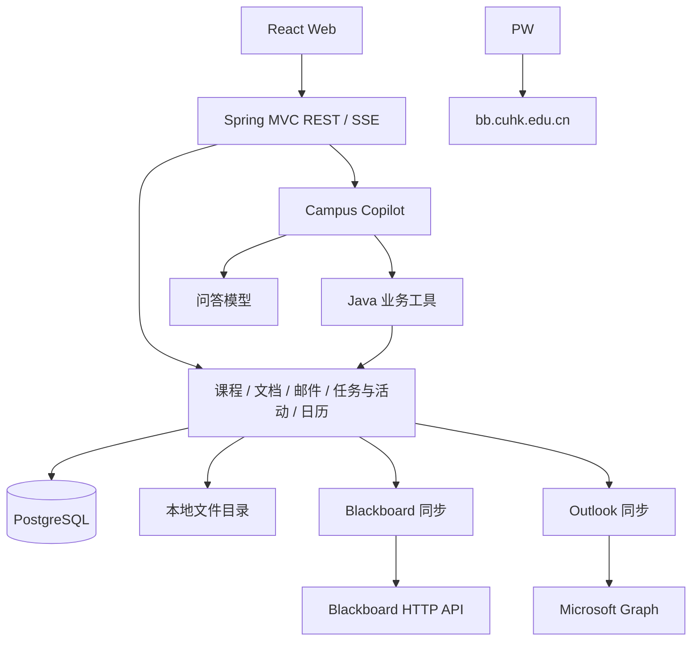
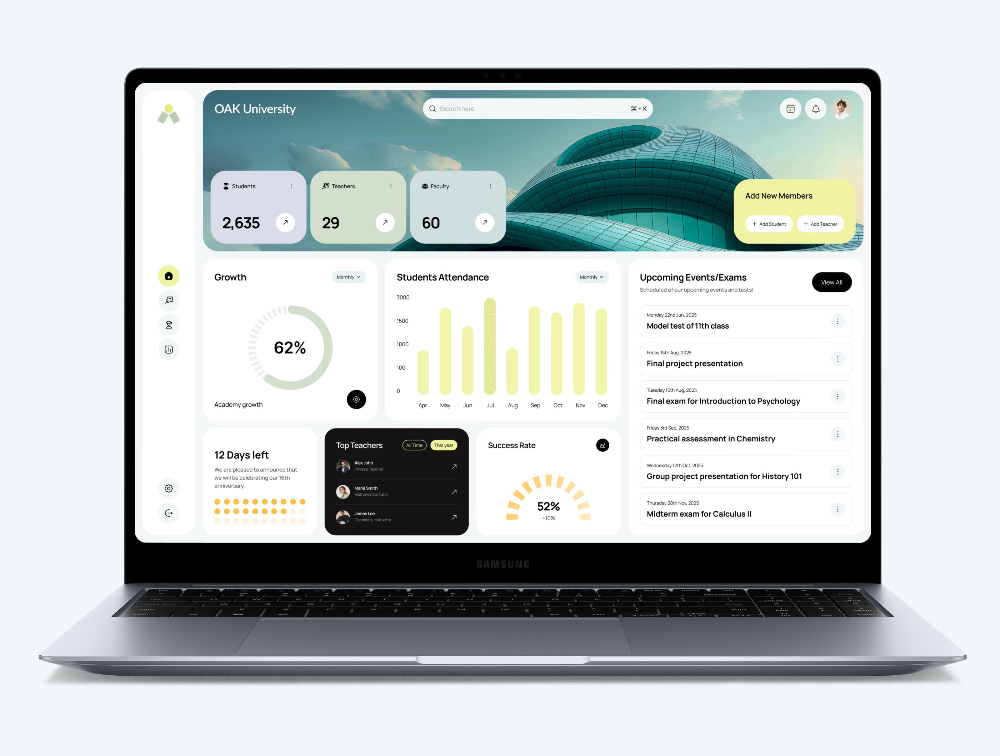

# CUHKCampus 完整开发文档

文档日期：2026-10-29  
项目名称：CUHKCampus  
AI 助手名称：Campus Copilot  
文档性质：产品与工程实现规格，供前后端、连接器和 AI 开发共同使用。

---

## 1. 产品定义与完整范围

CUHKCampus 是面向香港中文大学（深圳）学生的个人课程、资料、事务与学习管理应用。它将 Blackboard 课程资料和公告、Outlook 邮件、个人任务（含校园活动）及日历整合到一个工作空间，Campus Copilot 通过工具自主浏览这些数据，回答问题并协助创建待办与日程。

产品的核心使用链路是：

```text
连接 Blackboard / Outlook
        ↓
同步课程、内容、公告、邮件与附件
        ↓
建立可浏览、可按文件名搜索的个人资料库
        ↓
Agent 探索资料、回答问题、提取待办与校园活动
        ↓
管理任务/活动、日历安排与每日简报
```

完整功能包含以下七个模块：

| 模块 | 提供的能力 | 核心产出 |
|---|---|---|
| 校园总览 | 今日课程、近期截止事项与活动、重要邮件、公告、今日简报 | 一屏掌握当天安排 |
| 课程中心 | 课程信息、内容树、公告、课件、课程笔记 | 每门课的统一工作空间 |
| 文档库 | 文件导入、原文件预览与下载、文件名搜索 | 统一管理的课程与个人资料 |
| 邮件中心 | Outlook 同步、分类、摘要、课程关联、已读状态 | 可操作的校园事务 |
| 任务与活动中心 | 作业、个人事务与校园活动统一管理、优先级、进度、报名与截止信息 | 统一的个人事务与活动清单 |
| 日历与规划 | 学期课表、考试、活动日程、任务截止、学习时段规划 | 统一时间安排 |
| Campus Copilot | 独立 AI 聊天页面、新建与继续对话、统一聊天历史、Agent 工具调用及跨资料探索 | 可持续对话的个人 AI 助手 |

---

## 2. 统一技术决策

| 领域 | 确定方案 |
|---|---|
| 运行方式 | 用户电脑上运行的个人 Web 应用；浏览器访问本机后端 |
| 后端 | Java 21、Spring Boot 4.1.2、Spring MVC |
| AI | Spring AI 2.0.2；API Key 接入 OpenAI-compatible 服务，或通过 ChatGPT OAuth 使用订阅额度；Agent 与翻译分别配置模型 |
| 架构 | 按业务模块组织的单体应用、单个 Maven 工程 |
| 数据库 | PostgreSQL 17、Spring Data JPA、Flyway |
| Blackboard | Chrome DevTools Protocol 一次性登录并读取 Cookie；同步直接请求课程 API |
| Outlook | Microsoft Graph v1.0、用户委派 OAuth、邮件读取与日历写入 |
| 文件存储 | 本机文件目录存储原文件，数据库存储文档元数据 |
| 前端 | React 19、TypeScript、Vite、React Router、TanStack Query |
| UI 与日历 | Tailwind CSS、FullCalendar、Markdown/数学公式渲染 |
| 实时通信 | Spring MVC SSE（用于 AI 流式问答） |
| 认证 | Spring Security，本地账号和服务端 Session |

---

## 3. 总体架构与运行拓扑



本机后端同时负责业务 API、连接器同步和 AI 问答。连接器直接发出 HTTP 请求，文件目录位于用户电脑。PostgreSQL 由 Docker Compose 启动，后端在宿主机运行。

---

## 4. 基础约定

- **身份与会话**：用户注册本地账号并登录，BB 和 Outlook 连接绑定到该账号。后端使用 Session Cookie，前端与 API 同源。
- **主键与外部 ID**：应用主键使用 UUID；BB 内部 ID 和 Graph ID 保存为 `externalId` 字符串。
- **时间与时区**：时间点使用 `timestamptz`（Java `Instant`，API ISO 8601），用户默认时区 `Asia/Shanghai`。

---

## 5. 功能与业务规则

### 5.1 校园总览

首页展示：当天课表、未完成且近期到期的任务与活动、未读重要邮件、近期公告和每日摘要。

首页及各业务页面共用左侧主菜单，包含校园总览、课程中心、文档库、邮件中心、任务与活动、日历与规划及 **Copilot**。Copilot 作为独立菜单项，点击进入专用 AI 聊天页面 `/copilot`，当前菜单项保持选中状态。

顶部的 **CUHK Campus** 标题、日期和用户头像只在校园总览显示，其他页面直接展示各自内容。

### 5.2 课程中心

支持按学期、课程代码和名称筛选，可设置课程自定义名称、颜色、归档状态和备注。
课程详情包含内容目录、公告、文档资料、相关任务和课程笔记。内容树节点类型为 `FOLDER`、`ITEM`、`LINK`、`ASSIGNMENT`。

### 5.3 文档库

支持 PDF、PPTX、DOCX、TXT、Markdown、PNG、JPEG 等文件的存储与在线预览。每个文档可关联课程和内容节点，或作为独立个人资料上传。

文档库支持多级文件夹、面包屑、网格与列表视图、按文件名搜索，以及按名称、类型、大小和时间排序。文件与文件夹支持重命名、移动和删除；文件支持多选上传、批量移动、删除和 ZIP 下载。列表及详情展示格式、大小、来源、所属课程和创建、修改时间。

5.3.1 文档浏览界面  
阅读器顶部同一行放置返回文档库、文件名、下载及 Copilot 开关，文件名使用紧凑字号。左侧显示真实页面缩略图，中间展示当前页，右侧为可收起的 Copilot 问答栏（默认携带当前文档上下文）。PDF 使用 PDF.js 渲染；DOCX、PPTX 经本机 LibreOffice 转为 PDF 后使用同一阅读界面，保留原排版。

阅读器固定在可用窗口高度内，文档与缩略图分别滚动。文档区域中的上下方向键只滚动文档，底部不设置独立翻页条。可收起的翻译栏位于中间文档列内，与文档共享列宽，不覆盖缩略图或 Copilot。

文档翻译直接读取文档正文并调用单独配置的翻译模型，流式显示译文；翻译不创建 Copilot 会话，不写入聊天历史。

文档侧边栏按当前文档开启会话，并保存到统一聊天历史，可在独立 Copilot 页面打开并继续同一会话。

### 5.4 公告与邮件

- **公告**：按课程展示标题、正文摘要和日期，点击展开查看完整正文。AI 分析公告后若识别出待办或活动，提供一键加入任务中心。
- **邮件**：展示主题、发件人、时间、分类（`ACADEMIC`、`ADMINISTRATIVE`、`COLLEGE`、`ACTIVITY`、`GENERAL`）、重要程度（`HIGH`、`NORMAL`、`LOW`）、已读状态和关联课程。支持 AI 自动摘要、分类及提取任务/活动。

### 5.5 任务与活动中心

- **类型（**`taskType`**）**：`ASSIGNMENT`（作业）、`EXAM_PREPARATION`（备考）、`ACTIVITY`（校园活动）、`ADMINISTRATIVE`（行政事务）、`PERSONAL`（个人事务）、`OTHER`（其他）。
- **状态（**`status`**）**：`SUGGESTED`（AI 提取待确认）、`TODO`、`COMPLETED`、`CANCELLED`。用户确认 AI 建议后，状态由 `SUGGESTED` 转为 `TODO`。
- **优先级（**`priority`**）**：`HIGH`、`NORMAL`、`LOW`。
- **字段设计**：
  - 通用字段：标题、说明、关联课程（可选）、截止时间（`dueAt`）、是否收藏（`starred`）、来源类型与来源 ID（`sourceType` / `sourceId`，指向公告、邮件或作业节点）。
  - 活动专属字段（适用于 `ACTIVITY`）：主办方（`organizer`）、活动分类（`category`）、开始时间（`startsAt`）、结束时间（`endsAt`）、地点（`location`）

### 5.6 日历、课表与学习安排

日历统一展示五类事件：课程课次（`CLASS`）、考试（`EXAM`）、活动（`ACTIVITY`）、个人事件（`PERSONAL`）、学习时段（`STUDY`）。

- **课表生成**：根据课程时间规则（星期、起止时间、地点、有效日期）直接生成日历事件，支持单次修改或删除。
- **学习规划**：输入待安排任务及预计分钟数、可学习时段，避开已有日历事件，按默认 50 分钟学习 + 10 分钟休息切分并生成 `STUDY` 日历事件。

### 5.7 Copilot 聊天页面与历史记录

Copilot 是专门的 AI 聊天界面，用户进入后即可输入消息并与 AI 连续交流。

- 保留应用左侧主菜单，聊天页内侧为会话列表，中间为对话内容，底部为消息输入框和发送按钮。布局与视觉样式遵循第 11 章。
- 点击“新建对话”进入空白聊天界面，首次发送时创建会话，以首条消息作为默认标题，支持重命名和删除。
- 支持多轮对话、Markdown、代码块、数学公式和流式回答。用户可以直接提问，也可以选择课程或文档作为本轮上下文；AI 按需调用第 9 章的业务工具。
- 所有 AI 聊天入口共用会话与消息存储，历史统一展示在 Copilot 会话列表中，按最近消息时间倒序排列，支持按标题搜索和分页浏览。历史列表可收起，聊天正文随之扩展。
- 点击历史会话后加载消息与资料引用，并可继续提问。独立页面使用 `/copilot/:conversationId` 定位会话，文档侧边栏可打开同一会话。
- 用户消息、AI 回答及引用资料保存到 PostgreSQL，刷新、重新登录或重启应用后仍可查看。历史按账号归属，用户可主动删除会话。后台摘要、分类和简报由各业务模块保存。

### 5.8 设置

设置页使用分区导航，分为个人资料、AI 模型和数据连接。各分区使用浅绿、浅紫、浅杏等色彩区分。

- 个人资料支持姓名、学校、书院、专业、学号、时区、个人简介和头像配色，保存到账号与 `preferences`。
- AI 模型分别配置 Agent 与文档翻译的调用方式、服务地址、API Key 和模型，独立保存在当前账号。每项均可选择 API Key 或 ChatGPT 订阅调用；两者共用已授权的 ChatGPT 账号，各自选择模型。
- API Key 加密保存到 `users.preferences`；页面可测试模型连接、获取服务端模型列表，并在模型名称输入时自动补全。
- 数据连接集中管理 Blackboard 登录、Outlook 授权、邮件文件夹与手动同步。

---

## 6. 后端模块与项目目录

```text
cuhk-campus/
├── backend/
│   ├── pom.xml
│   └── src/main/java/com/cuhkcampus/
│       ├── CuhkCampusApplication.java
│       ├── auth/              # 用户、登录会话、连接配置
│       ├── course/            # 课程、内容树、公告、笔记
│       ├── document/          # 文档存储、下载预览、搜索
│       ├── mail/              # 邮件、文件夹、AI 分类摘要
│       ├── task/              # 统一的任务与校园活动管理
│       ├── calendar/          # 日历事件、课表规则、学习时段规划
│       ├── agent/             # Copilot 会话与历史、流式问答、业务 Tools、每日简报
│       ├── integration/
│       │   ├── blackboard/    # 会话认证、课程 API、附件下载
│       │   └── outlook/       # OAuth、Graph 邮件 delta 同步
│       └── common/            # 基础配置与通用工具
├── frontend/
│   ├── src/features/          # 与后端业务模块一一对应
│   ├── src/components/
│   └── src/lib/
└── deploy/compose.yml
```

核心服务职责：

| 服务 | 主要职责 |
|---|---|
| `CourseService` | 课程管理、目录与内容节点读取、公告、课程笔记 |
| `DocumentService` | 文件上传落盘、原文件预览与下载、按文件名搜索 |
| `MailService` | 邮件查询、状态更新、AI 分类与摘要 |
| `TaskService` | 任务与校园活动的增删改查、AI 建议确认、收藏与状态流转 |
| `CalendarService` | 课表生成、日历查询、事件管理、学习时段自动规划 |
| `AgentService` | 统一会话与消息持久化、历史检索与续聊、Spring AI 工具调用循环、每日简报生成 |
| `BlackboardSyncService` | 调用 Blackboard API，同步课程、内容、公告与附件 |
| `OutlookSyncService` | 调用 Graph API，增量同步邮件与附件 |

---

## 7. 数据模型与数据库契约

核心数据由以下 16 张表组成：

### 7.1 账号、课程与文档

| 表名 | 核心字段 |
|---|---|
| `users` | `id`, `email`, `password_hash`, `display_name`, `timezone`, `preferences jsonb` |
| `external_connections` | `id`, `user_id`, `provider` (`BLACKBOARD/OUTLOOK/CHATGPT`), `account_identifier`, `credentials jsonb` (加密 OAuth 凭据), `status`, `last_synced_at` |
| `courses` | `id`, `user_id`, `external_id`, `code`, `name`, `custom_name`, `term`, `teacher`, `color`, `archived`, `note`, `last_synced_at` |
| `content_nodes` | `id`, `course_id`, `parent_id`, `external_id`, `node_type` (`FOLDER/ITEM/LINK/ASSIGNMENT`), `title`, `body_html`, `body_text`, `due_at`, `source_url`, `position` |
| `announcements` | `id`, `course_id`, `external_id`, `title`, `body_html`, `body_text`, `published_at`, `is_read` |
| `document_folders` | `id`, `user_id`, `parent_id` 可空, `name`, `created_at`, `updated_at` |
| `documents` | `id`, `user_id`, `folder_id` 可空, `course_id` 可空, `content_node_id` 可空, `mail_message_id` 可空, `external_id` 可空, `display_name`, `mime_type`, `byte_size`, `sha256`, `storage_key`, `origin` (`BLACKBOARD/OUTLOOK/UPLOAD`), `created_at`, `updated_at` |
| `course_notes` | `id`, `user_id`, `course_id`, `document_id` 可空, `title`, `markdown` |

### 7.2 邮件、任务/活动、日历与 AI

| 表名 | 核心字段 |
|---|---|
| `mail_folders` | `id`, `connection_id`, `external_id`, `display_name`, `selected`, `delta_link`, `last_synced_at` |
| `mail_messages` | `id`, `user_id`, `folder_id`, `course_id` 可空, `external_id`, `subject`, `sender jsonb`, `received_at`, `body_html`, `body_text`, `web_link`, `category`, `importance`, `is_read`, `summary` |
| `tasks` | `id`, `user_id`, `course_id` 可空, `task_type` (`ASSIGNMENT/EXAM_PREPARATION/ACTIVITY/ADMINISTRATIVE/PERSONAL/OTHER`), `title`, `description`, `status` (`SUGGESTED/TODO/COMPLETED/CANCELLED`), `priority` (`HIGH/NORMAL/LOW`), `due_at` 可空, `estimated_minutes` 可空, `organizer` 可空, `category` 可空, `starts_at` 可空, `ends_at` 可空, `location` 可空, `registration_url` 可空, `starred`, `source_type` 可空 (`ANNOUNCEMENT/MAIL/CONTENT`), `source_id` 可空 |
| `course_meeting_rules` | `id`, `course_id`, `weekday`, `starts_time`, `ends_time`, `valid_from`, `valid_to`, `location` |
| `calendar_events` | `id`, `user_id`, `course_id` 可空, `task_id` 可空, `meeting_rule_id` 可空, `event_type` (`CLASS/EXAM/ACTIVITY/PERSONAL/STUDY`), `title`, `starts_at`, `ends_at`, `all_day`, `location` |
| `conversations` | `id`, `user_id`, `title`, `created_at`, `last_message_at` |
| `chat_messages` | `id`, `conversation_id`, `role` (`USER/ASSISTANT`), `content`, `context_refs jsonb`（本轮引用的资料类型与 ID）, `tool_calls jsonb`, `created_at` |
| `briefings` | `id`, `user_id`, `local_date`, `content_markdown`, `generated_at` |

会话属于当前登录用户，消息通过 `conversation_id` 关联会话，按 `created_at`、`id` 升序展示。删除会话时级联删除消息。`context_refs` 保存用户本轮选择的资料；文档侧边栏发送消息时自动带入当前文档。

---

## 8. 外部集成规格

### 8.1 Blackboard 集成

使用 `BlackboardLoginService` 启动一次性 Chrome 窗口；认证成功后由 `BlackboardApiConnector` 访问 `https://bb.cuhk.edu.cn` 的已登录接口，关闭窗口且不保留后台浏览器。

1. **连接**：数据连接中点击登录后打开 BB 登录窗口。后端轮询 `/learn/api/public/v1/users/me`，验证成功后自动读取站点 Cookie、加密保存到当前账号并关闭窗口。会话过期时再次打开登录窗口。
2. **课程**：分页读取 `/users/me/courses`，保存课程、学期和教师；合并课程以父课程为准。
3. **内容**：递归读取 `/courses/{id}/contents` 及子节点，保留层级、正文和外部链接。不可访问的隐藏节点不递归。作业通过关联的成绩列读取截止时间。
4. **公告与附件**：分页同步公告，只保存附件名称、类型、大小和 BB 来源路径。用户打开预览、读取正文或下载文档时，文档 API 才按附件 ID 拉取单个原文件，计算 SHA-256 后持久化并复用缓存。
5. **处理**：同步与 AI 提取独立。数据同步成功后可手动提取建议任务，不依赖模型是否配置。

### 8.2 Outlook 集成

使用普通用户网页 OAuth 授权码与 PKCE 流程，用户在数据连接中保存自己注册的 Client ID，无需 Client Secret。回调为 `http://localhost:8080/api/v1/connections/outlook/callback`，注册为移动和桌面应用回调。权限限定为 `offline_access User.Read Mail.Read Calendars.ReadWrite`，均为委派权限。学校租户的用户同意策略仍可能限制授权。

1. **邮件同步**：勾选文件夹后调用 `/me/mailFolders/{id}/messages/delta`，使用不可变邮件 ID，保存正文及附件并记录增量链接。
2. **邮件搜索**：邮件中心显式执行“搜索 Outlook”，调用 `/me/messages?$search=...`，检索云端邮件并保存匹配结果。
3. **日历写入**：用户在日程中点击“添加到 Outlook”，将该条日程的标题、时间、时区及地点写入 `/me/events`，不自动添加参会者。
4. **AI 处理**：邮件同步与模型独立；用户可进一步提取摘要、分类和建议任务。

### 8.3 ChatGPT 订阅授权

个人本地应用通过官方 Sign in with ChatGPT 动态注册流程接入，使用 PKCE、授权码和已授权的计划权限。每台安装保存一个稳定的 `ext_agent_host_id`，账号连接及加密凭据保存到 `external_connections`。回调地址为 `http://127.0.0.1:8080/api/v1/connections/chatgpt/callback`。

订阅调用使用 Responses API，设置 `store: false`、`stream: true`；API Key 调用继续使用 OpenAI-compatible 服务。用户在设置中分别选择 Agent 和翻译模型。订阅用量计入原有计划额度，具体权限和模型以授权及实际调用结果为准。[官方接入文档](https://developers.openai.com/siwc/token-sharing-open-source)、[模型与推理契约](https://developers.openai.com/siwc/token-sharing-open-source/models-and-inference)。

---

## 9. Campus Copilot 与 Agent Tools

### 9.1 执行方式

使用 Spring AI `ChatClient` 与 `@Tool` 注解方法。模型在问答过程中自主调用工具查询数据库或创建建议项，流式输出回答并保存至 `chat_messages`。

所有聊天入口共用会话 ID 和消息接口：保存用户消息，根据会话历史与本轮引用资料调用模型，通过 SSE 输出回答，生成结束后保存 AI 回答及工具调用记录，更新会话最近消息时间。继续对话时读取同一会话的历史消息。

### 9.2 精简工具目录

| Tool | 参数 | 用途 |
|---|---|---|
| `list_courses` | `term?, query?` | 获取课程列表 |
| `get_course_content` | `courseId, parentId?` | 浏览课程目录树或节点详情 |
| `list_announcements` | `courseId?, limit?` | 查看近期公告及正文 |
| `search_documents` | `filename?, courseId?` | 按文件名或课程检索文档列表 |
| `read_document` | `documentId` | 读取文档元数据及文本内容 |
| `list_mail` | `category?, courseId?, query?, limit?` | 搜索或筛选邮件 |
| `read_mail` | `mailId` | 读取邮件全文与附件列表 |
| `list_tasks` | `courseId?, taskType?, status?, dueFrom?, dueTo?` | 查询任务与校园活动（含 `SUGGESTED` 建议项） |
| `create_or_update_task` | `taskId?, taskType, title, courseId?, description?, status?, priority?, dueAt?, estimatedMinutes?, startsAt?, endsAt?, location?, organizer?, category?` | 创建待确认任务/活动（默认 `SUGGESTED`）或更新已有项 |
| `get_calendar_events` | `from, to` | 查询指定时间段内的日历事件 |
| `plan_study_sessions` | `taskIds, from, to` | 根据任务耗时与空闲区间生成学习时段 |
| `trigger_sync` | `provider, courseId?` | 触发 Blackboard 或 Outlook 数据同步 |

---

## 10. REST API 契约

API 统一前缀为 `/api/v1`。列表接口统一支持基础过滤参数，直接返回数组或 `{ items, total }`。

### 10.1 认证与连接

| Method | 路径 | 行为 |
|---|---|---|
| POST | `/auth/register` | 注册本地账号 |
| POST | `/auth/login` | 登录建立 Session |
| POST | `/auth/logout` | 退出登录 |
| GET / PATCH | `/auth/me` | 获取当前用户信息；更新时区与偏好 |
| GET | `/connections` | 查看 BB 与 Outlook 连接状态 |
| POST | `/connections/blackboard/login` | 启动或验证 Blackboard 登录 |
| GET | `/connections/outlook/authorize` | 获取 Outlook 用户授权地址 |
| GET | `/mail/search` | 搜索 Outlook 云端邮件并保存结果 |
| POST | `/calendar/events/{id}/outlook` | 将日程添加到本人 Outlook 日历 |
| GET / PATCH | `/connections/outlook/folders` | 获取邮件文件夹；保存同步勾选 |
| GET | `/connections/chatgpt/authorize` | 获取 ChatGPT 授权地址 |
| GET | `/connections/chatgpt/callback` | 接收 ChatGPT OAuth 回调 |
| GET | `/connections/chatgpt/status` | 获取账号连接与计划授权状态 |
| GET | `/connections/chatgpt/models` | 获取授权账号的模型目录 |
| POST | `/connections/{provider}/sync` | 触发指定数据源同步（可选传 `courseId`） |
| DELETE | `/connections/{provider}` | 断开连接 |

### 10.2 课程、内容与文档

| Method | 路径 | 行为 |
|---|---|---|
| GET / POST | `/courses` | 课程列表；手动创建课程 |
| GET / PATCH | `/courses/{id}` | 课程详情；修改自定义名称、颜色、学期、归档与备注 |
| GET | `/courses/{id}/content?parentId=` | 获取课程目录节点 |
| GET | `/content/{id}` | 获取单个内容节点详情与关联附件 |
| GET | `/announcements?courseId=` | 公告列表 |
| GET / PATCH | `/announcements/{id}` | 公告详情；标记已读 |
| GET / POST | `/document-folders` | 列出 `parentId` 下的文件夹；创建文件夹 |
| GET / PATCH / DELETE | `/document-folders/{id}` | 获取文件夹与祖先目录；重命名或移动；删除目录及内容 |
| GET / POST | `/documents` | 文档列表（支持 `filename`、`courseId`、`folderId` 筛选，`folderId=root` 表示根目录）；上传文件并关联文件夹 |
| GET / PATCH / DELETE | `/documents/{id}` | 文档元数据；修改名称或关联课程；删除文档 |
| GET | `/documents/{id}/file` | 原文件下载与在线预览；BB 文档在首次访问时按需拉取 |
| GET | `/documents/{id}/preview` | Word、PowerPoint、Excel 转换后的 PDF 原排版预览 |
| GET | `/documents/{id}/text` | 读取文档正文 |
| POST | `/documents/download` | 按选中的文件与文件夹生成 ZIP 下载 |
| POST | `/documents/{id}/translate` | 使用翻译模型生成译文，通过 SSE 返回，不写入聊天历史 |
| GET / POST | `/courses/{id}/notes` | 课程笔记列表；创建笔记 |
| PATCH / DELETE | `/notes/{id}` | 更新或删除笔记 |

### 10.3 邮件、任务与活动（统一）

| Method | 路径 | 行为 |
|---|---|---|
| GET | `/mail?category=&courseId=&isRead=&q=` | 邮件列表筛选 |
| GET / PATCH | `/mail/{id}` | 邮件详情；更新已读状态、分类、重要程度或关联课程 |
| POST | `/mail/{id}/extract` | 触发 AI 从该邮件提取任务或活动 |
| GET / POST | `/tasks` | 查询任务与校园活动（支持 `taskType`、`status`、`courseId`、`starred` 筛选）；创建任务或活动 |
| GET / PATCH / DELETE | `/tasks/{id}` | 获取详情；修改字段或状态（如将 `SUGGESTED` 确认为 `TODO`，或标为 `COMPLETED`）；删除 |
| POST | `/tasks/{id}/calendar-event` | 将任务或校园活动一键加入日历 |

### 10.4 日历与总览

| Method | 路径 | 行为 |
|---|---|---|
| GET | `/calendar?from=&to=` | 查询区间内的日历事件与任务截止项 |
| POST | `/calendar/events` | 创建个人日历事件 |
| PATCH / DELETE | `/calendar/events/{id}` | 修改或删除日历事件 |
| GET / POST | `/courses/{id}/meeting-rules` | 查询或创建课程上课时间规则（自动生成课次） |
| DELETE | `/meeting-rules/{id}` | 删除课表规则及其课次 |
| POST | `/calendar/study-plan` | 传入任务 ID 与时间范围，自动规划并生成学习时段 |
| GET | `/dashboard?date=` | 首页总览聚合数据 |
| GET / POST | `/briefings?date=` | 获取当日简报；重新生成简报 |

### 10.5 Copilot 会话与消息

| Method | 路径 | 行为 |
|---|---|---|
| GET | `/conversations?q=&page=&size=` | 获取当前用户会话列表；`q` 按标题搜索，按最近消息时间倒序返回 `{ items, total }` |
| POST | `/conversations` | 首次发送时新建会话，接收 `title`（首条消息），返回会话 ID |
| GET | `/conversations/{id}` | 获取会话信息 |
| PATCH | `/conversations/{id}` | 修改会话标题 |
| DELETE | `/conversations/{id}` | 用户主动删除会话及其全部消息 |
| GET | `/conversations/{id}/messages?page=&size=` | 分页获取消息，按创建时间和 ID 升序返回 `{ items, total }` |
| POST | `/conversations/{id}/messages` | 接收 `content` 与可选 `contextRefs`，保存用户消息并通过 SSE 返回 AI 回答 |

SSE 使用 `delta` 传输回答片段，回答保存后发送 `done`，其中包含已保存的 AI 消息。

---

## 11. 前端界面设计风格

以下图片作为全站视觉参考，页面内容使用 CUHKCampus 的课程、资料、任务与日历数据。



### 11.1 布局与视觉

采用参考图中的浅色画布、独立窄侧栏、大圆角卡片和低饱和配色。通过留白、字号和模块位置建立层级，每个区域保留一个清晰标题，操作直接放在对应内容旁。

- 左侧主菜单为独立白色圆角栏，顶部放应用标志，中部排列业务入口，底部放设置和退出。入口使用统一线性图标，悬停显示名称，当前入口以淡黄绿色圆底突出；Copilot 与其他业务入口并列。
- 主内容区顶部放页面名称、搜索框和用户头像。首页使用横向校园图片横幅，将页面名称与少量关键数据卡片放在横幅内，文字区域保持清晰可读。
- 首页下方采用宽窄结合的卡片网格：左侧展示今日课程与任务概况，右侧展示近期截止事项、考试和活动列表。卡片高度和间距对齐，以真实业务内容组织页面。
- 列表使用清晰的行间距和轻分隔线，卡片使用白底或浅色底，少量重点模块可用深色底。保留平面、轻盈的质感，避免厚重阴影和重复嵌套卡片。
- 按钮采用胶囊形或圆形，主要操作使用深色底，选中态和重点提示使用淡黄绿色。图标按钮以图形表达操作，悬停显示名称。

### 11.2 颜色与尺寸

以下数值是依据参考图确定的实现基准。

| 项目 | 基准 |
|---|---|
| 页面背景 | `#F1F6F7` |
| 卡片与导航背景 | `#FFFFFF` |
| 主要文字与主按钮 | `#171717` |
| 次要文字 | `#747A7D` |
| 强调色 | 淡黄绿色 `#F1F6A5` |
| 辅助色 | 鼠尾草绿 `#D6E0CF`、浅灰紫 `#DCDDE9`、浅青灰 `#D1E1E1` |
| 分隔线 | `#E8EDEE` |
| 圆角 | 页面容器及横幅 28–32px，卡片 24px，列表项及输入框 12–16px |
| 间距 | 以 8px 为基准；页面内边距 24px，卡片间距 16px，卡片内边距 20–24px |
| 字体 | 本地托管 Geist Variable 与 Noto Sans SC Variable；正文 14–16px，卡片标题 16–18px，页面标题 24–28px，关键数字 28–36px |

### 11.3 业务页面应用

- **校园总览**：沿用参考图的图片横幅与卡片网格，突出当天课程、待办和近期活动；图表只用于已有的学习或任务统计。
- **课程、邮件与任务**：共用导航、搜索与卡片样式，主体以列表和详情为主，状态使用少量色彩标记。
- **文档浏览**：顶部紧凑工具栏，左侧真实缩略图，中间独立滚动的单页预览与翻译栏，右侧可收起 Copilot，使用轻分隔线划分区域。
- **Copilot**：沿用浅色背景和窄侧栏，可收起的会话列表与聊天正文并排；正文居中并限制阅读宽度，底部放圆角输入框。用户消息使用浅色气泡，AI 回答以正文排版展示，引用资料显示为可点击的紧凑条目。空白会话只保留“新建对话”和输入框。
- **设置**：左侧分区导航，右侧展示当前设置；个人资料、模型与连接使用不同浅色主题，头像配色可即时预览。

### 11.4 动效

页面切换使用约 260ms 的淡入与轻微位移；按钮、导航、卡片交互使用 180–220ms 的颜色、阴影与位置变化。面板收起时同步调整内容宽度，弹窗与新消息使用短促淡入。系统开启减少动态效果时，停用位移动画。

参考图中的学校名称、师生管理、人员排名和示例统计不属于产品功能；前端按本文定义的学生个人工作空间实现。
